# Manual de usuario — The Zone

**Asignatura:** DSY1104 Desarrollo Fullstack II · Evaluación Parcial 3
**Equipo:** Maximiliano Provoste · Patricio Ormazabal · Basthian Vernal

The Zone es una tienda en línea de artículos gamer. Este manual recorre primero lo que puede hacer
un visitante o cliente, y después el panel de administración.

---

## 1. Antes de empezar

La aplicación tiene dos partes que deben estar andando: el **backend** (la API y la base de datos)
y el **frontend** (lo que se ve en el navegador).

```bash
# 1. Base de datos
docker start thezone-mysql

# 2. Backend
cd tienda && mvn spring-boot:run

# 3. Frontend
cd tienda-online && npm run dev
```

Con eso, la tienda queda en **http://localhost:5173**.

### Cuentas de prueba

| Rol | Correo | Clave | Qué puede hacer |
|---|---|---|---|
| Administrador | `admin@thezone.cl` | `Admin123` | Todo, incluido el panel de administración. |
| Cliente | `pedro@example.com` | `Cliente123` | Comprar y editar su propio perfil. |

> También se puede comprar **sin cuenta**. La diferencia es que una compra como invitado no queda
> asociada a ningún historial.

---

## 2. La tienda

### 2.1 Página de inicio

Al entrar a http://localhost:5173 aparece la portada con las categorías, los productos en oferta y
el video promocional.

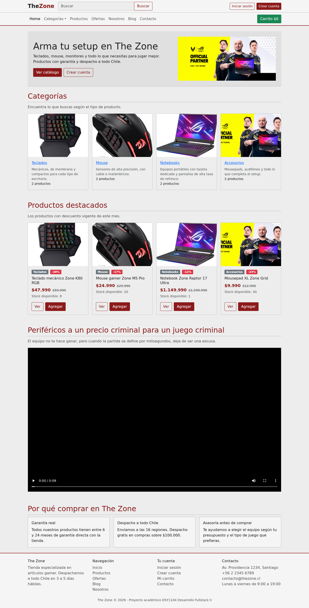

En la barra superior están, de izquierda a derecha: el logo (vuelve al inicio), el buscador, los
botones de sesión y el menú con el carrito, que muestra siempre el total acumulado.

### 2.2 Catálogo de productos

**Productos** en el menú abre el catálogo completo.

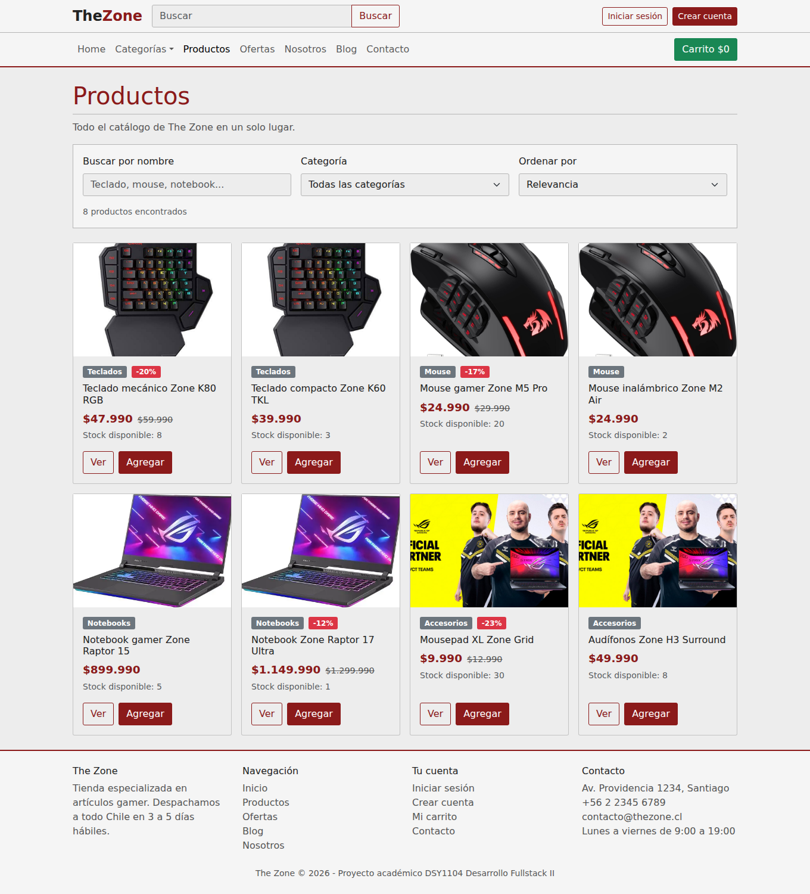

Arriba hay tres filtros que se pueden combinar:

- **Buscar por nombre:** escribe parte del nombre y el listado se reduce mientras escribes.
- **Categoría:** limita a teclados, mouse, notebooks o accesorios.
- **Ordenar:** por relevancia, por precio de menor a mayor, de mayor a menor, o por nombre.

Cada tarjeta muestra la foto, la categoría, el precio y el botón **Agregar**. Si un producto está
en oferta aparece el precio rebajado junto al anterior tachado y el porcentaje de descuento. Si el
stock llegó a cero, la tarjeta dice **Sin stock** y el botón queda deshabilitado.

### 2.3 Ficha de un producto

Al hacer clic en el nombre de un producto se abre su ficha.

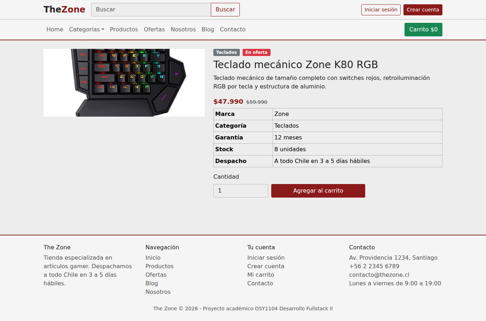

Ahí está la descripción completa y la ficha técnica con marca, categoría, garantía, stock
disponible y plazo de despacho. Puedes elegir la **cantidad** antes de presionar **Agregar al
carrito**; el máximo que acepta es el stock disponible.

### 2.4 Ofertas y categorías

**Ofertas** reúne todos los productos con descuento vigente.

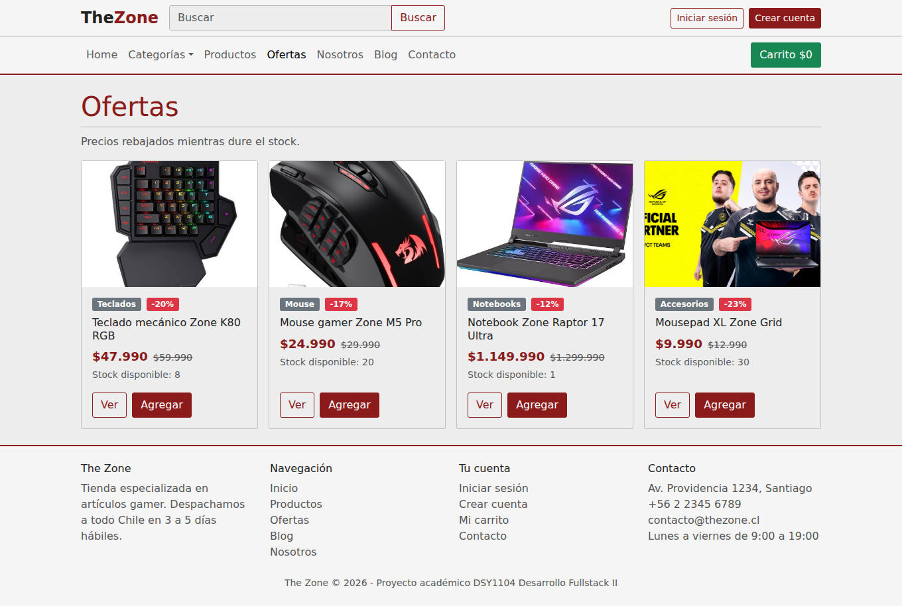

**Categorías** muestra los cuatro grupos con la cantidad de productos de cada uno, y más abajo el
listado completo separado por grupo.

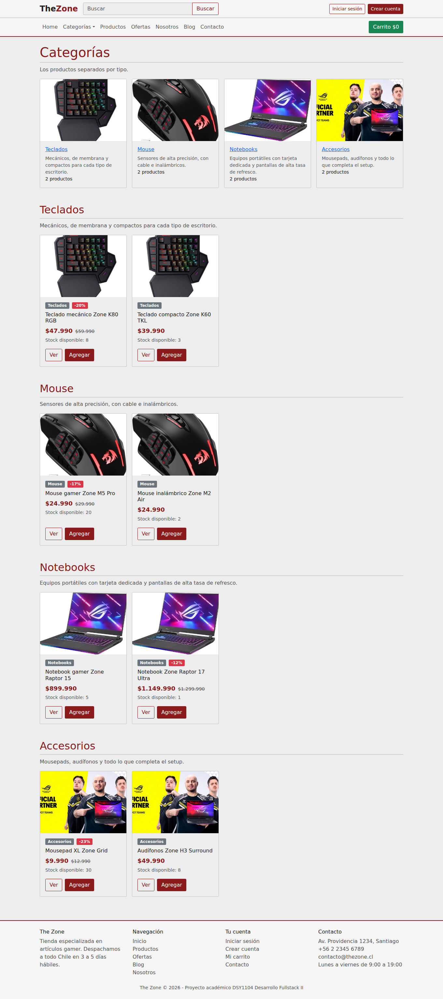

### 2.5 Crear una cuenta

**Crear cuenta** abre el formulario de registro.

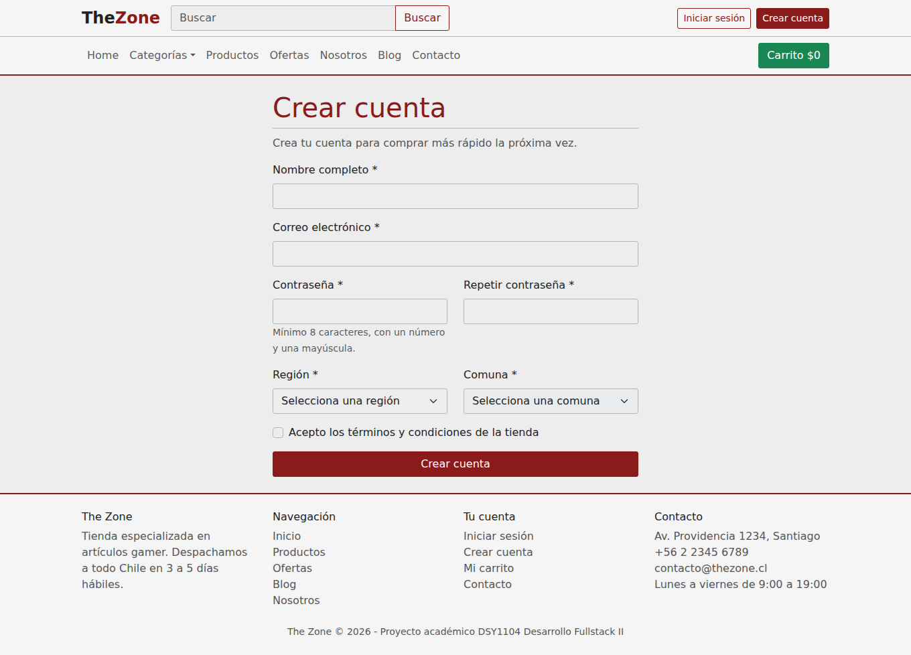

Todos los campos se validan antes de enviar y el error aparece bajo el campo correspondiente:

| Campo | Qué se exige |
|---|---|
| Nombre completo | Nombre y apellido separados por un espacio. |
| Correo | Formato válido. Si escribes `gmail.cm` el sistema sugiere la corrección. |
| Contraseña | Mínimo 8 caracteres, con al menos un número y una mayúscula. |
| Repetir contraseña | Debe coincidir con la anterior. |
| Región y comuna | La lista de comunas se arma según la región elegida. |
| Términos | Hay que marcar la casilla. |

Si el correo ya está registrado, el servidor lo rechaza y el mensaje aparece arriba del formulario.
Cuando el registro es correcto, la sesión **queda iniciada automáticamente**.

### 2.6 Iniciar sesión

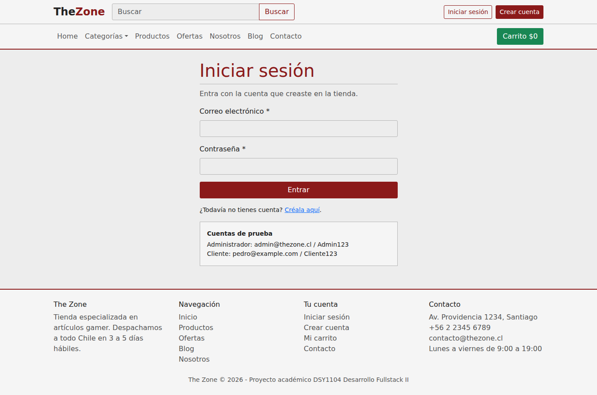

Escribe correo y contraseña y presiona **Entrar**. Si los datos no coinciden, el aviso rojo explica
el motivo: la cuenta no existe, la contraseña no coincide, o la cuenta fue desactivada.

Al entrar, un administrador va directo al panel; un cliente vuelve a la portada. La sesión
**sobrevive a recargar la página**: si presionas F5 sigues conectado.

### 2.7 Carrito de compras

El botón verde del menú abre el carrito.

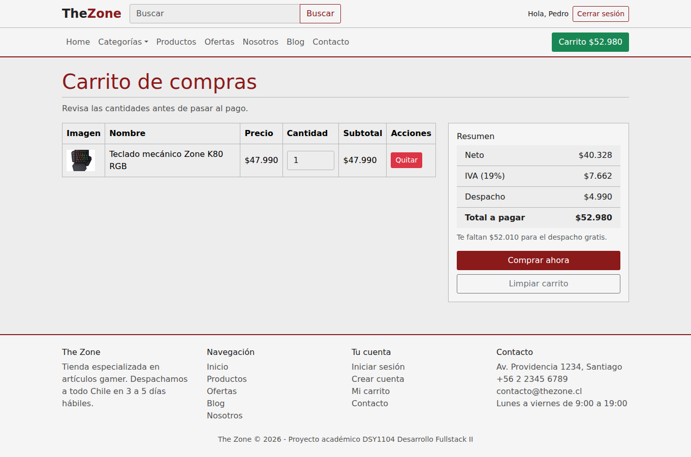

En la tabla puedes cambiar la **cantidad** de cada línea o **Quitar** el producto. El resumen de la
derecha se recalcula solo y muestra neto, IVA, despacho y total.

> **Despacho:** cuesta $4.990 y es **gratis** en compras sobre $100.000. El resumen te dice cuánto
> te falta para alcanzarlo.

### 2.8 Pagar

**Comprar ahora** lleva al formulario de pago.

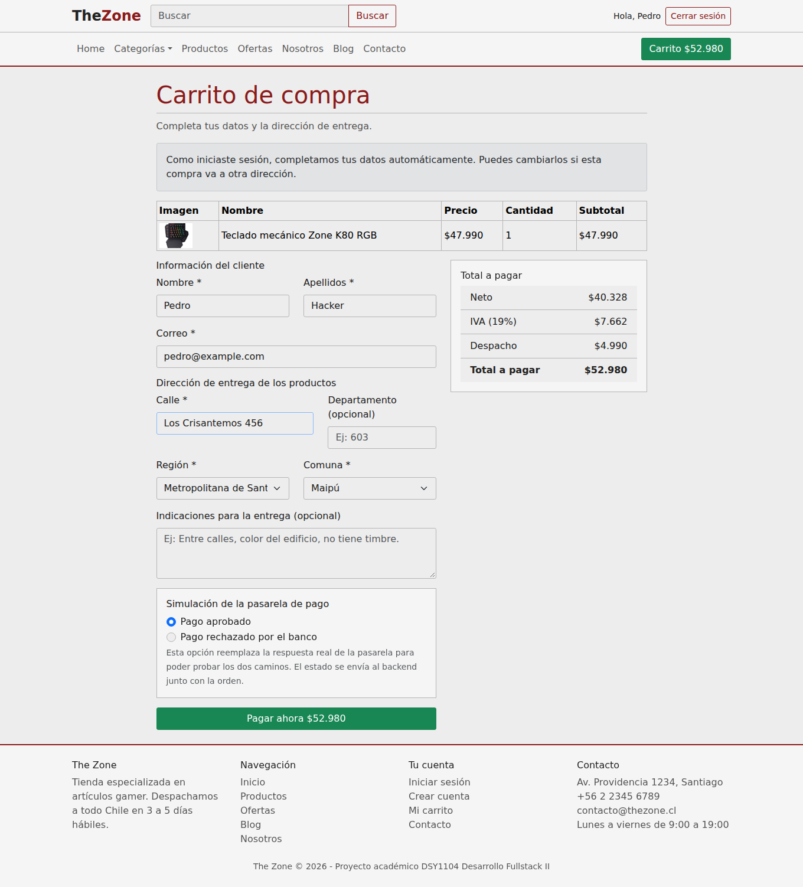

Si iniciaste sesión, tus datos vienen precargados y puedes cambiarlos si el envío va a otra
dirección. Son obligatorios el nombre, los apellidos, el correo, la calle, la región y la comuna.

Abajo hay un bloque llamado **Simulación de la pasarela de pago** con dos opciones, *Pago aprobado*
y *Pago rechazado por el banco*. Reemplaza la respuesta de un banco real para poder probar los dos
caminos; la opción elegida se envía al servidor junto con la orden.

### 2.9 Boleta

Con el pago aprobado llegas a la boleta.

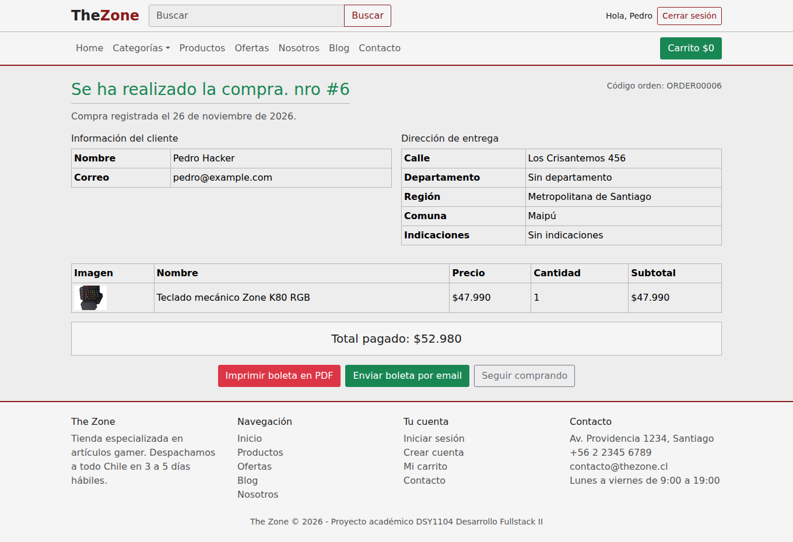

La boleta trae el número de orden, el código (`ORDER00006` en el ejemplo), la fecha, los datos del
cliente, la dirección de entrega, el detalle de los productos y el total pagado. Desde ahí puedes
**imprimirla en PDF**, **enviarla por email** o **seguir comprando**.

Al aprobarse el pago el carrito se vacía y **el stock de los productos se descuenta** de inmediato.

Si eliges *Pago rechazado*, la pantalla lo informa, **el carrito se conserva** y aparece el botón
**Volver a realizar el pago** para intentarlo otra vez.

---

## 3. Panel de administración

Solo las cuentas con rol **administrador** pueden entrar. Si un cliente escribe `/admin` en la
barra de direcciones, el sistema lo devuelve a la portada.

Para entrar: inicia sesión con `admin@thezone.cl` y presiona **Administración** en la barra
superior.

### 3.1 Dashboard

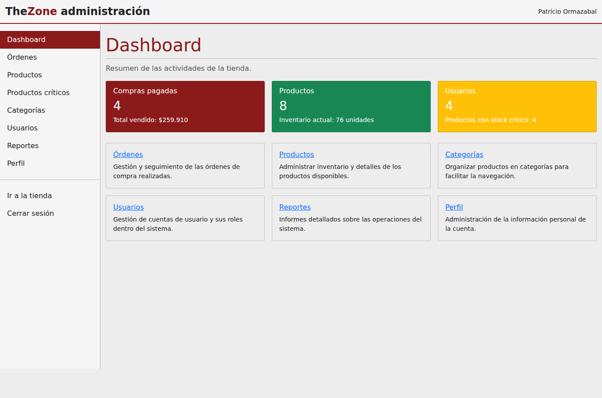

Las tres tarjetas de arriba resumen el estado de la tienda: compras pagadas con el total vendido,
cantidad de productos con el inventario total, y cuentas registradas con el número de productos en
stock crítico. Abajo están los accesos a cada sección, que también están en el menú lateral.

### 3.2 Productos

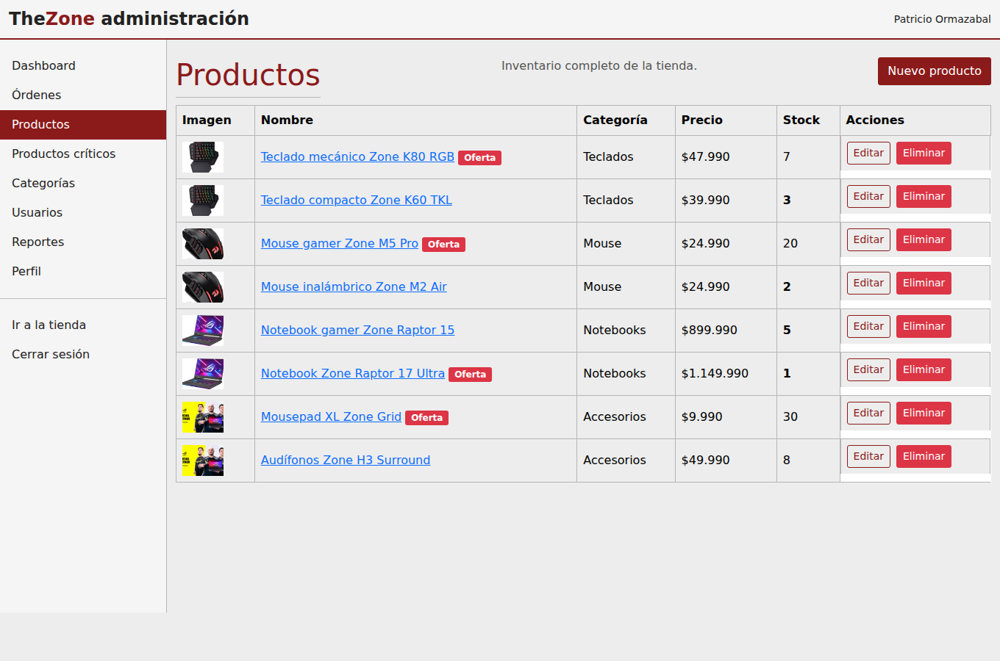

La tabla lista todo el inventario. Los productos con stock igual o menor a 5 aparecen con el número
**en rojo**. Desde aquí puedes **Editar** o **Eliminar** cada uno, o crear uno nuevo con **Nuevo
producto**.

Al eliminar, el sistema pide confirmación antes de borrar.

### 3.3 Crear o editar un producto

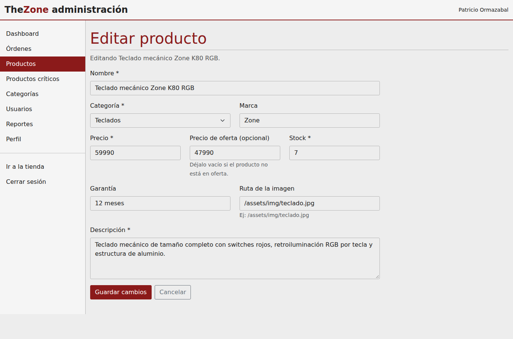

| Campo | Observación |
|---|---|
| Nombre | Obligatorio. |
| Categoría | Obligatorio; la lista sale de las categorías existentes. |
| Marca y garantía | Opcionales, vienen con un valor por defecto. |
| Precio | Obligatorio, número positivo. |
| Precio de oferta | Opcional. **Debe ser menor que el precio normal**, o el formulario lo rechaza. |
| Stock | Obligatorio, número positivo o cero. |
| Ruta de la imagen | Opcional; si la dejas vacía se usa una imagen genérica. |
| Descripción | Obligatoria. |

### 3.4 Categorías

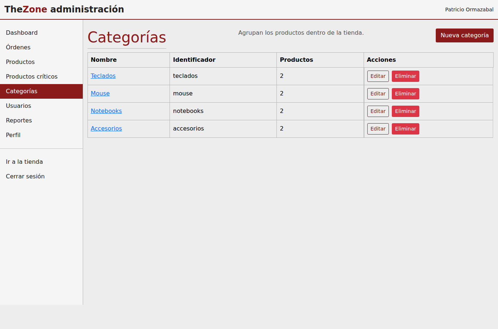

Cada fila muestra el nombre, el identificador interno (*slug*) y cuántos productos tiene asociados.

> Una categoría **con productos asociados no se puede eliminar**. Primero hay que mover o borrar
> esos productos. El sistema lo avisa con un mensaje en rojo en vez de dejar productos huérfanos.

### 3.5 Usuarios

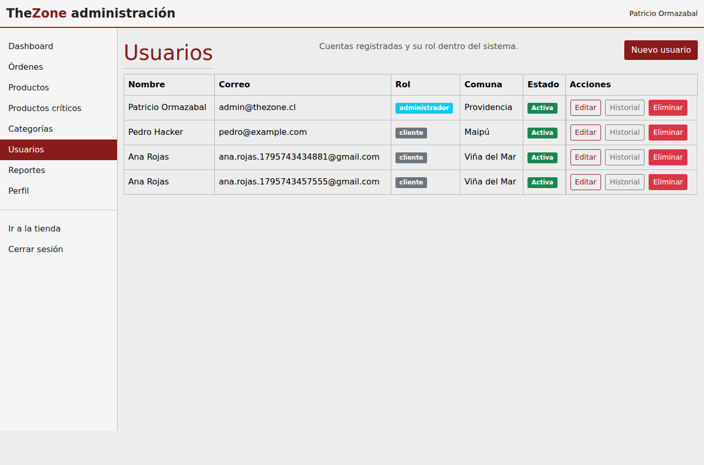

El listado muestra nombre, correo, rol, comuna y si la cuenta está activa. Por cada cuenta hay tres
acciones: **Editar**, **Historial** (sus compras) y **Eliminar**.

Dos resguardos:

- No puedes eliminar **la cuenta con la que estás conectado**.
- No puedes eliminar **al único administrador** que queda en el sistema.

Al editar una cuenta, dejar la contraseña vacía significa "no cambiarla".

### 3.6 Órdenes y boletas

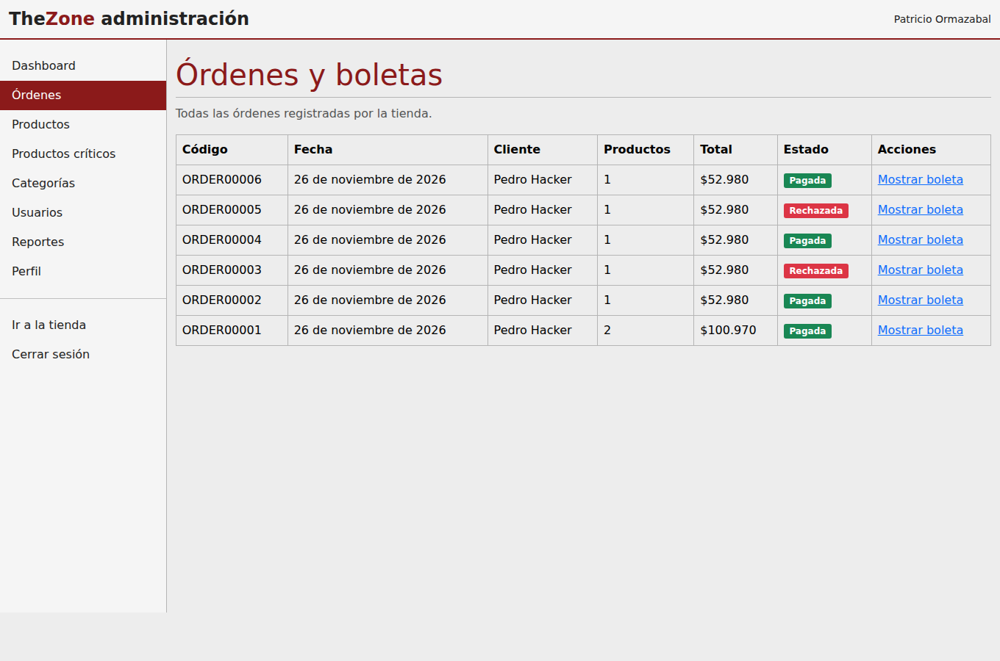

Todas las órdenes de la tienda, con código, fecha, cliente, unidades, total y estado (*Pagada* o
*Rechazada*). **Mostrar boleta** abre el detalle completo, que se puede imprimir.

### 3.7 Productos críticos

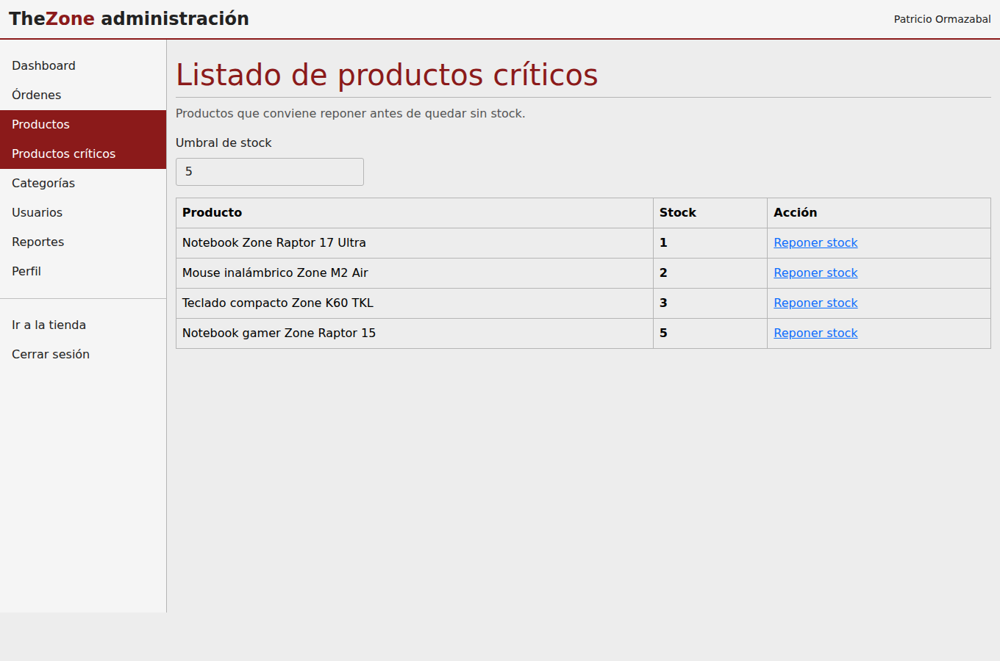

Lista los productos que conviene reponer. El **umbral de stock** es ajustable: por defecto son 5
unidades, pero puedes subirlo o bajarlo y la lista se actualiza al instante. **Reponer stock** lleva
directo al formulario de ese producto.

### 3.8 Reportes

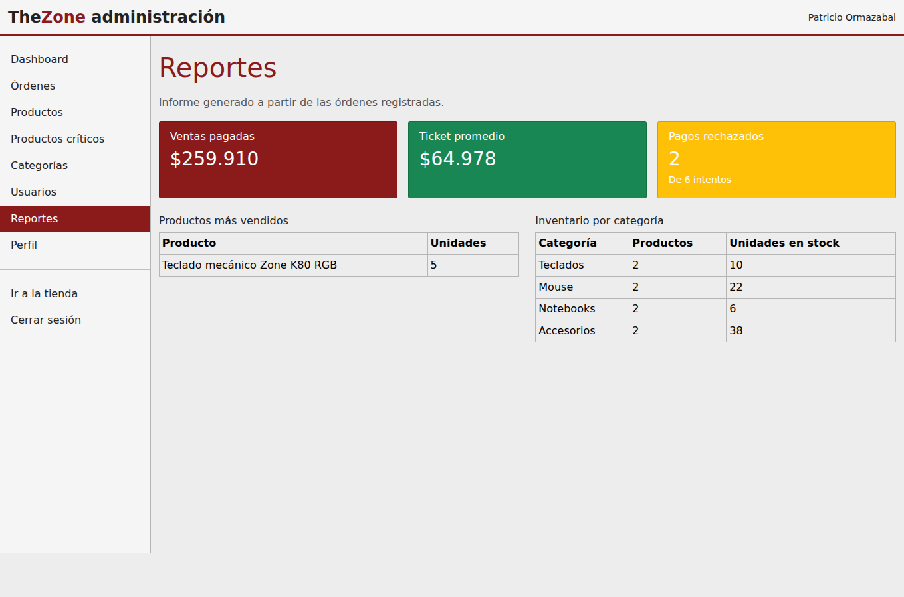

Tres indicadores arriba —ventas pagadas, ticket promedio y pagos rechazados— y dos tablas abajo: los
cinco productos más vendidos y el inventario agrupado por categoría.

### 3.9 Perfil

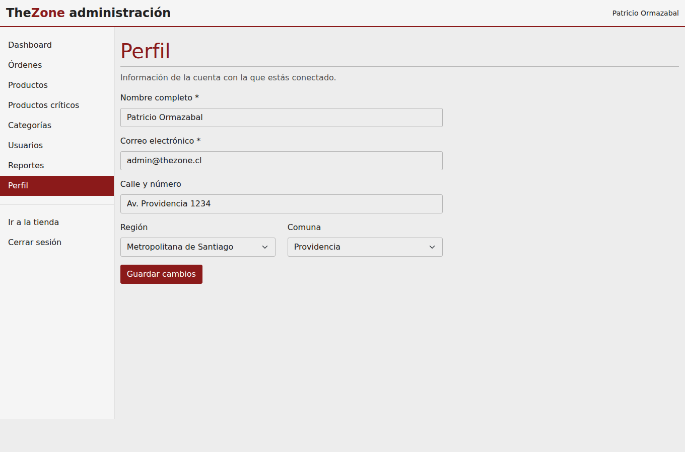

Los datos de la cuenta con la que estás conectado. Puedes cambiar nombre, correo y dirección. Los
cambios se guardan en el servidor y la sesión se actualiza sin tener que volver a entrar.

---

## 4. Problemas frecuentes

| Qué ves | Qué pasa | Cómo se arregla |
|---|---|---|
| "No se pudo conectar con el servidor" | El backend no está andando. | Levanta el backend con `mvn spring-boot:run` y recarga. |
| "Tu sesión expiró. Vuelve a iniciar sesión." | El token duró más de 2 horas. | Vuelve a iniciar sesión. |
| "No tienes permisos para hacer esto." | Una cuenta de cliente intentó una acción de administrador. | Entra con la cuenta de administrador. |
| "No hay stock suficiente de..." | Otra compra se adelantó y dejó menos unidades. | Baja la cantidad en el carrito y paga de nuevo. |
| El catálogo aparece vacío | La base de datos está sin datos. | Reinicia el backend: carga las semillas si las tablas están vacías. |
| Te devuelve a la portada al entrar a `/admin` | Estás con una cuenta de cliente. | Cierra sesión y entra como administrador. |

---

## 5. Documentación técnica de la API

Con el backend andando, la documentación interactiva de todos los endpoints está en:

**http://localhost:8080/swagger-ui.html**

Desde ahí se puede probar cada endpoint. Para los que exigen permisos, primero se ejecuta
`POST /api/auth/login`, se copia el valor de `token` de la respuesta y se pega en el botón
**Authorize** de la parte superior.
